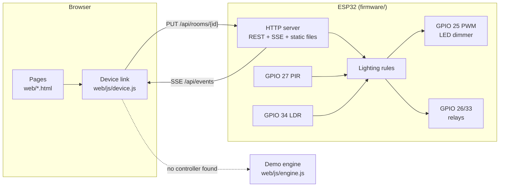

# Nather — ESP32 smart lighting

[](https://github.com/ayoubosa/nather-smart-light/actions/workflows/ci.yml)

Wi-Fi lighting controller for a home: an ESP32 drives a dimmable LED and two
relays, a PIR sensor switches lights on when someone walks in after dark, and
a web app controls every room live from any phone or laptop on the network.

**[Live demo](https://ayoubosa.github.io/nather-smart-light/)** runs a
simulated controller in your browser. On the real board the same pages are
served by the ESP32 at `http://nather.local`.

## What it does

- **Room control:** on/off and 0–100 % brightness per room, with gamma-corrected PWM dimming and relay switching.
- **Entry lighting:** the PIR detects motion, and the rooms you picked switch on only when the light sensor says it is dark. They switch off again after 5 minutes of no movement.
- **Live sync:** change a light on your phone and every other open page updates within about 100 ms, using Server-Sent Events.
- **Network-ready:** DHCP hostname, mDNS name, a fallback Wi-Fi hotspot, an optional API token, and a documented REST API.
- **Works without hardware:** a mock controller and an in-browser demo implement the same API and rules.

## Architecture



The device link finds a controller (same origin, then a saved address) and
falls back to demo mode. Every write is an idempotent absolute value. The
controller pushes the full state to every client after each change.

## Run it

### Without hardware

```bash
npm start          # mock controller + website on http://localhost:8080
npm test           # rules engine + HTTP contract tests (Node 20+)
```

Open the control panel, select a room under *Entry Lighting*, and press
**Simulate motion**. Open a second tab to watch both stay in sync.

### On an ESP32

Needs [PlatformIO](https://platformio.org/install/cli) and an ESP32 DevKit (WROOM-32).

```bash
cd firmware
cp include/secrets.example.h include/secrets.h   # Wi-Fi name, password, optional API token
pio run -t upload && pio run -t uploadfs          # firmware, then the website
pio device monitor                                # prints the IP and http://nather.local
```

Wiring, pin choices and light-sensor calibration: [docs/WIRING.md](docs/WIRING.md).

## Documentation

| | |
|---|---|
| [docs/API.md](docs/API.md) | REST endpoints, state schema, SSE format, curl examples |
| [docs/NETWORK.md](docs/NETWORK.md) | Topology, boot sequence (DHCP, ARP, mDNS, HTTP), Wireshark filters, security, IoT VLAN with a Cisco IOS ACL example |
| [docs/WIRING.md](docs/WIRING.md) | Pin map, schematic notes, flashing |
| [docs/DECISIONS.md](docs/DECISIONS.md) | Why each design choice was made |

## Repository layout

```text
web/            website (served by the ESP32, GitHub Pages and the mock)
  js/engine.js    lighting rules, shared by demo mode and the mock
  js/device.js    controller discovery, REST + SSE client, connection panel
  js/script.js    page behaviour
firmware/       PlatformIO project for the ESP32
tools/          mock controller and tests
docs/           API, network, wiring and design notes
```

## Background

The hardware started as a graduation project in electronics engineering: a
PIR-triggered smart light on an ESP32. This repository turns it into a full
networked system: firmware with a documented API, a live web app, a mock
for testing, and the network design and analysis around it.

## Roadmap

- MQTT bridge for Home Assistant
- OTA firmware updates
- Packet Tracer lab of the IoT VLAN design in `docs/NETWORK.md`
- TLS via a reverse proxy on a Raspberry Pi
