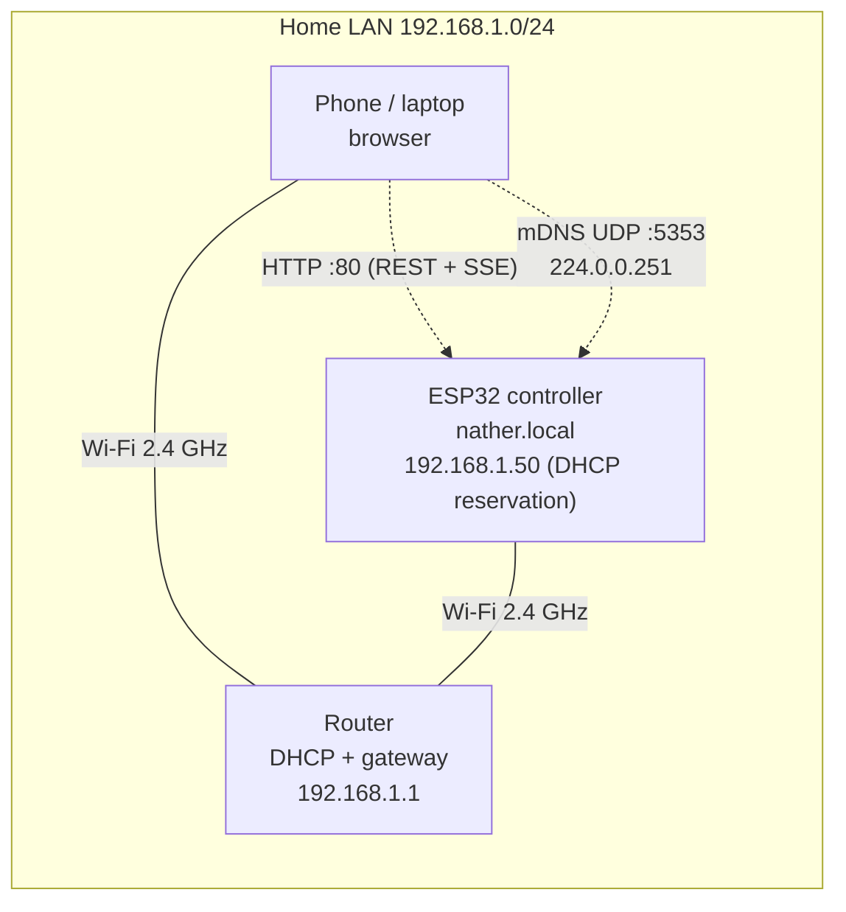

# Network design

How the Nather controller lives on a home network, what goes over the wire,
and how to see it for yourself in Wireshark.

## Topology



Fallback when the home Wi-Fi is down (30 s with no network at boot, or 3
minutes after a drop): the controller opens its own WPA2 hotspot
`Nather-Setup` and scans for the home network every 30 seconds. It is the gateway and DHCP server at `192.168.4.1`,
so you can still control the lights directly from a phone.

## What happens when the board starts

| Step | Protocol | Port | What to look for |
|---|---|---|---|
| 1. Join the Wi-Fi | 802.11 + WPA2 4-way handshake | – | ESP32 is 2.4 GHz only (802.11 b/g/n) |
| 2. Get an address | DHCP (DORA) | UDP 67/68 | Option 12 hostname = `nather`, so it shows up by name in the router |
| 3. Resolve the gateway | ARP | – | Who-has 192.168.1.1 |
| 4. Announce itself | mDNS | UDP 5353 → 224.0.0.251 | A record `nather.local`, service `_http._tcp` |
| 5. Serve | HTTP/1.1 | TCP 80 | Pages from LittleFS, `/api/*` JSON |

When a browser opens `http://nather.local`:

1. The OS sends an mDNS query for `nather.local` to 224.0.0.251, and the ESP32 answers with its IP.
2. TCP three-way handshake to port 80, then `GET /` and the assets.
3. `GET /api/state`: one JSON snapshot.
4. `GET /api/events`: a long-lived response (`text/event-stream`). Every change and a 10-second heartbeat arrive on this one TCP connection.
5. A tap on a switch sends `PUT /api/rooms/living` with `{"brightness":50}`, and every other open page gets the new state over its own event stream.

## Addressing choices

- **DHCP reservation, not a static IP in firmware.** The router stays the single source of truth for addressing, and the firmware works on any network. Reserve the ESP32's MAC (shown in the connection panel and on the serial log) to a fixed address.
- **mDNS name `nather.local`.** No DNS server needed. mDNS is link-local multicast, so it does **not** cross routers or VLANs (see below).
- **Wi-Fi power saving off** (`WiFi.setSleep(false)`). Modem sleep delays every reply noticeably. The board runs on mains power, so latency matters more than milliwatts.
- **Fast rejoin.** The board remembers the router's BSSID and channel, so it rejoins without scanning every channel. Retries back off from 1 s to 60 s. The logic is in `firmware/src/wifi_policy.cpp` and is unit-tested.

## Capturing it in Wireshark

On a switched or Wi-Fi network your laptop only sees its **own** conversations
with the ESP32, plus broadcast and multicast. That is enough for everything
below if you capture on the laptop that runs the browser.

Display filters (replace the IP with your controller's):

| Goal | Filter |
|---|---|
| Everything to/from the controller | `ip.addr == 192.168.1.50` |
| Name resolution | `mdns && dns.qry.name == "nather.local"` |
| Address assignment (capture while the board boots) | `dhcp && dhcp.option.hostname == "nather"` |
| Only API calls | `http.request.uri contains "/api/"` |
| Only writes | `http.request.method == "PUT"` |
| The live event stream | `http.content_type contains "event-stream"`, then *Follow → TCP Stream* |
| Connection setup | `tcp.flags.syn == 1 && ip.addr == 192.168.1.50` |
| Round-trip time per segment | add `tcp.analysis.ack_rtt` as a column |
| The API token in clear text | `http.authorization` |

Things worth noticing:

- **One TCP connection per open page** carries all live updates. Count them with *Statistics → Conversations → TCP*, and compare with `device.clients` in `/api/state`.
- **Heartbeat every 10 s** on the event stream, even when nothing changes.
- **Dragging the dial** sends a burst of small `PUT`s, but never more than one in flight per room (`web/js/device.js` queues them). Look at the gaps between requests and their responses.
- **The token is visible.** Plain HTTP means anyone who can capture the traffic can read it. That is why the controller belongs on an isolated network, covered next.

## Security posture

| Risk | Mitigation in this project | Next step |
|---|---|---|
| Anyone on the LAN can switch lights | Optional bearer token on all writes | Network isolation (below) |
| Token readable on the wire (no TLS) | Keep the controller on a trusted or isolated segment | TLS-terminating reverse proxy (Caddy or nginx on a Pi) in front of it |
| Exposure to the internet | None: the device makes no outbound connections and needs no port forwarding | Keep it that way. Use a VPN (WireGuard) for remote access |
| Oversized or malformed requests | 512-byte body limit, strict JSON validation, `4xx` errors | – |
| Wi-Fi credentials in the repo | `secrets.h` is git-ignored, and only `secrets.example.h` is committed | – |

## Putting it on an IoT VLAN (Cisco IOS example)

A common home or small-office design puts IoT devices on their own VLAN so a
compromised gadget cannot reach laptops. Users may reach the controller, and
the controller may only reply.

```text
! VLAN 10 = users 192.168.10.0/24, VLAN 30 = IoT 192.168.30.0/24
vlan 30
 name IOT
!
interface GigabitEthernet0/2
 description Access point SSID "home-iot"
 switchport mode access
 switchport access vlan 30
!
interface Vlan30
 ip address 192.168.30.1 255.255.255.0
 ip access-group IOT-IN in
!
ip dhcp excluded-address 192.168.30.1 192.168.30.49
ip dhcp pool IOT
 network 192.168.30.0 255.255.255.0
 default-router 192.168.30.1
!
ip dhcp pool NATHER
 host 192.168.30.50 255.255.255.0
 client-identifier 01xx.xxxx.xxxx.xx   ! 01 + the controller's MAC
!
ip access-list extended IOT-IN
 remark DHCP from IoT clients
 permit udp any eq bootpc any eq bootps
 remark controller may only answer users (replies to their TCP sessions)
 permit tcp host 192.168.30.50 eq www 192.168.10.0 0.0.0.255 established
 deny   ip any any log
```

Consequences to plan for:

- **mDNS stops working across VLANs.** `nather.local` will not resolve from VLAN 10. Either use the reserved IP, add a DNS record on the router, or enable an mDNS gateway/reflector (Cisco calls this the Service Discovery Gateway; many home routers call it an "mDNS repeater").
- **No internet for the controller.** It does not need any, and the browser still loads web fonts itself.
- `established` matches TCP segments with ACK or RST set, so the long-lived SSE response is allowed while the controller still cannot open connections into the user VLAN.

> This configuration is a design example written for this project. Test it in
> Packet Tracer or on lab gear before you use it on a real network.

## Troubleshooting

| Symptom | Check |
|---|---|
| `nather.local` does not resolve | Windows needs Bonjour or Windows 10+; Android before 12 has poor mDNS support, so use the IP. Different VLAN? See above. |
| Page loads, badge says *Reconnecting…* | Something is closing the SSE connection: a proxy, a captive portal, or the board rebooting (watch the serial log). |
| Board never joins Wi-Fi | 5 GHz-only network, wrong password, or MAC filtering. Join `Nather-Setup`, then fix `secrets.h` and reflash. |
| Slow replies | Weak signal: check `rssi` in the connection panel. Below about −75 dBm, move the board or the access point. |
| Works from laptop, not from phone | The phone is on a guest network with client isolation. |
